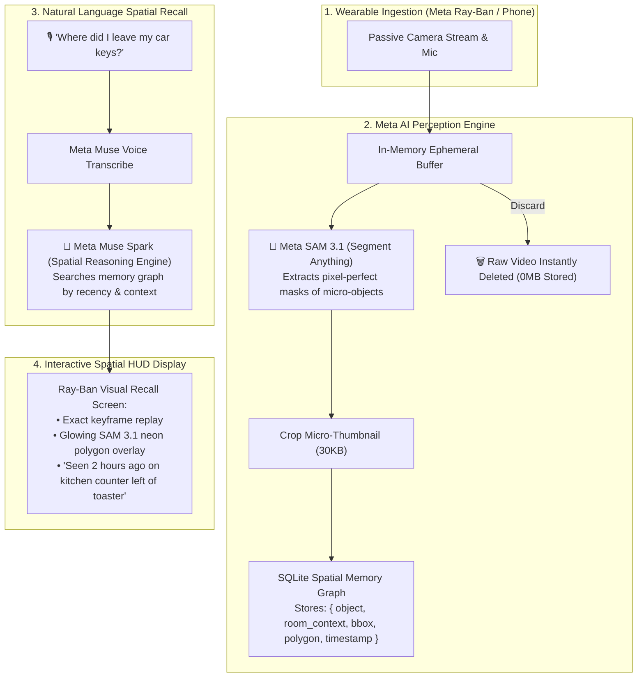

# 👓 SpatialRecall — Ctrl+F for the Physical World

> **Episodic Spatial-Temporal Memory Engine for Wearables & Smart Glasses**  
> *Built for the Meta Global AI Developer Hackathon 2026 · Track: Indie Developer*

[](https://dev.meta.ai/)
[](https://fastapi.tiangolo.com/)
[](https://react.dev/)
[](https://github.com/)
[](LICENSE)

---

## 🚀 The Vision: An Episodic Memory for Smart Glasses

Every human on Earth loses their keys, wallet, AirPods, tools, or medications right when they need to leave the house. People spend an average of **15 to 30 minutes every week retracing their steps in pure frustration**.

While smartphones and smart glasses (like **Meta Ray-Bans**) can see what is in front of you *right now*, **current AI has amnesia**—it has zero memory of what you looked at 2 hours ago.

**SpatialRecall** solves this by turning passive egocentric camera video into an **instant, searchable spatial memory of physical reality**. You speak naturally into your glasses or phone, and Meta AI instantly recalls the exact moment and location where your item was last seen, highlighting it with glowing pixel precision on an interactive visual HUD.

---

## ⚡ The Breakthrough: Ephemeral Zero-Storage Architecture (<15MB/day)

A naive system that saves continuous 1080p video would devour **50+ GB of storage per day** and drain wearable batteries in an hour.

**SpatialRecall** uses an **Ephemeral Metadata Architecture**:
1. **Scene-Change Keyframing:** Only extracts 1 frame every 3–5 seconds when motion or gaze shifts.
2. **Instant Raw Video Discard:** Raw video is processed in RAM and **permanently deleted immediately**.
3. **Micro-Crop & SQLite Metadata Graph:** Only stores a tiny 30KB thumbnail crop and lightweight JSON bounding box coordinates:
   $$\text{Daily Storage} \approx 100 \text{ objects} \times (1\text{ KB JSON} + 30\text{ KB thumb}) \approx \mathbf{3.1\text{ MB per day!}}$$

---

## 🏗️ System Architecture



---

## 🛠️ Meta Models Used

* **Meta SAM 3.1 (Segment Anything):** Performs zero-shot spatial segmentation on micro-objects (keys, wallets, tools, chargers), generating pixel-accurate boundary polygons.
* **Meta Muse Voice Transcribe:** Transcribes natural spoken questions in noisy environments without touching a screen.
* **Meta Muse Spark:** Performs temporal and spatial reasoning over candidate memories, resolving ambiguous room contexts and recency.

---

## ⚡ Quick Start (Local Setup)

### Prerequisites
- Python 3.10+
- Node.js 18+
- Meta Model API Key ([dev.meta.ai](https://dev.meta.ai))

### 1. Clone & Setup Backend
```bash
git clone https://github.com/YashRaj1240/spatialrecall.git
cd spatialrecall/backend

# Create .env file (runs in realistic simulation mode out-of-the-box if key is omitted)
cp .env.example .env

# Run FastAPI Server
python -m uvicorn app.main:app --reload --port 8000
```
* Backend API Documentation: `http://127.0.0.1:8000/docs`
* Storage & System Health: `http://127.0.0.1:8000/api/health`

### 2. Setup Frontend
```bash
cd ../frontend
npm install
npm run dev
```
* Open your browser at: `http://localhost:3000`

---

## 🎬 3-Minute Demo Script

* **0:00 - 0:40 (The Problem):** 
  * "Everyone has lost their car keys or wallet 5 minutes before leaving the house. Current AI assistants can't help because they have zero memory of the physical world."
* **0:40 - 1:45 (The Magic Moment):**
  * Click **"Hands-Free Voice"** and speak: *"Where did I leave my car keys?"*
  * **BOOM:** The screen updates instantly with the kitchen counter keyframe. **SAM 3.1** paints a pulsating, glowing cyan polygon mask directly over the keys.
  * Muse Spark explains: *"Observed 2 hours and 14 minutes ago on the kitchen counter, left of the toaster."*
* **1:45 - 2:20 (The Timeline & Scale):**
  * Click **"Spatial Timeline"** to show all indexed personal items (wallet, AirPods, reading glasses, screwdriver) indexed throughout the day.
* **2:20 - 3:00 (The Edge Architecture):**
  * Show the live storage metric: **3.2 MB total footprint**.
  * Highlight that raw video is discarded immediately, preserving 100% user privacy and enabling real-world deployment on Meta Ray-Ban smart glasses.

---

## 🏆 Hackathon Submission Checklist

- [x] **New Work Only:** Clean repository created during the hackathon window (Oct 26 - Nov 4).
- [x] **Problem Statement Fit:** 100% aligned with *"Build for Your World"* (freeing up mental space) and *"Push the Frontier"* (giving machines episodic physical memory).
- [x] **Meta AI Tooling:** Deep synergy of **SAM 3.1**, **Muse Voice Transcribe**, and **Muse Spark**.
- [x] **Verifiable Architecture:** Privacy-first, deterministic spatial-temporal indexing with SQLite.
