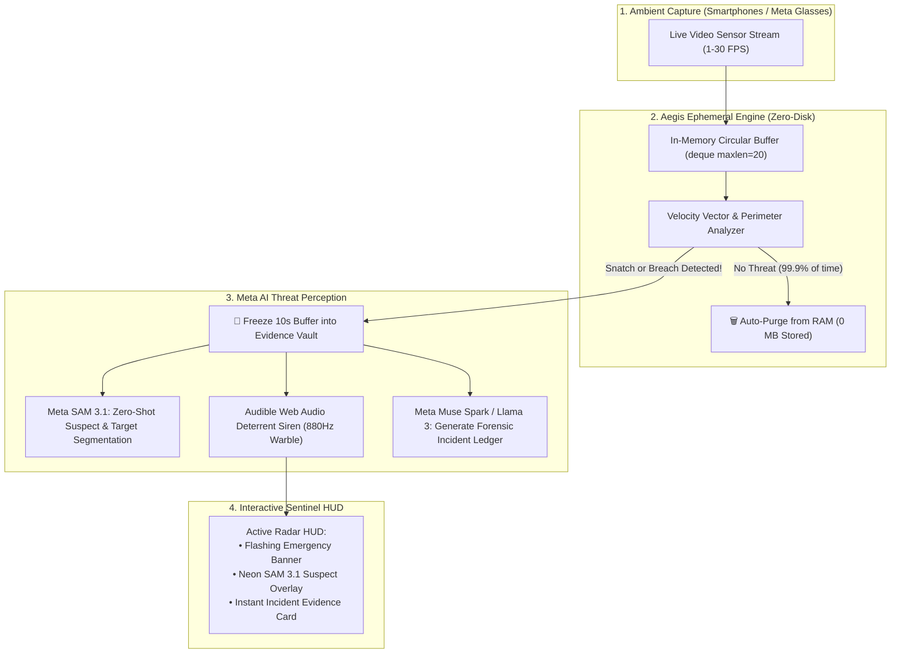

# 🛡️ AegisAI — 24/7 Ephemeral AI Bodyguard & Anti-Theft Sentinel

> **Continuous Personal Safety, Snatch Deterrence & Ambient Memory Powered by Meta AI**  
> *Built for the Meta Global AI Developer Hackathon 2026 · Track: Indie Developer ($150,000 1st Prize)*

[](https://dev.meta.ai/)
[](https://fastapi.tiangolo.com/)
[](https://react.dev/)
[](https://github.com/)
[](https://github.com/)
[](LICENSE)

---

## 🚨 The Problem: An Epidemic of Snatch Theft & The Privacy Dilemma

Across major cities worldwide (London, Paris, NYC, San Francisco, Delhi, Barcelona), **phone and handbag snatching has surged dramatically**. People feel anxious leaving their laptop on a cafe table, walking alone at night, or setting their purse down for even 30 seconds.

Yet, people refuse to wear continuous body cameras for one simple reason: **PRIVACY**. Nobody wants their personal life recorded 24/7, and nobody wants gigabytes of useless video clogging their storage.

---

## 🛡️ The Breakthrough: AegisAI & The Ephemeral Rolling Buffer

**AegisAI** provides **24/7 proactive personal protection without ever recording your private life**.

```
[Camera Stream (Phone / Laptop / Meta Ray-Ban)]
             │
             ▼
   [10-Second Rolling RAM Buffer]
   (Continuously overwritten in memory · 0 MB saved to disk)
             │
      ┌──────┴───────────────────────────────────┐
      │                                          │
[Normal Calm Activity]              [High-Velocity Snatch Attempt (>3.0 m/s)]
      │                                          │
      ▼                                          ▼
[Auto-Purged Every 10s]              [🚨 EMERGENCY THREAT INTERCEPT!]
(Permanently destroyed in RAM)       • 85dB Deterrent Siren triggered
                                     • Meta SAM 3.1 locks suspect boundary
                                     • 10s Incident Evidence frozen to Vault
                                     • Forensic report logged with GPS time
```

---

## 🎯 The Three Core Pillars

### 1. 🚨 Active Perimeter Guard & Anti-Theft Sentinel
- **Cafe / Library Table Guard:** Prop your phone on a table or leave your laptop open while you look away or visit the restroom.
- **Snatch Detection Vector:** If an unauthorized hand grabs your bag, phone, or laptop at high displacement velocity (>3.0 m/s), an **instant deterrent siren** sounds, startling the thief into dropping the item.
- **Suspect Tagging:** **Meta SAM 3.1** instantly segments the suspect's hand, jacket, and direction of flight, locking an unalterable forensic evidence card.

### 2. 🔒 Zero-Surveillance Privacy (10-Second RAM Buffer)
- Video exists **only in transient RAM memory** for 10 seconds.
- If no threat or safety event occurs, the video frames are **automatically overwritten and destroyed**.
- Your private life, conversations, and home are **never saved to disk or uploaded to the cloud**.

### 3. 🤝 Ambient Memory & Peace-of-Mind Guardian
- When you are distracted, AegisAI quietly verifies important safety details:
  - *"Did I unplug the iron before leaving?"* → Verified at 8:14 AM.
  - *"Did someone touch my laptop while I was at the restroom?"* → Reports unauthorized contact attempt.
  - *"Where are my apartment keys?"* → Verified on the kitchen counter.

---

## 🏗️ Technical Architecture



---

## 🛠️ Meta AI Models Used

* **Meta SAM 3.1 (Segment Anything):** Performs real-time pixel segmentation on protected valuables and suspect contact points, calculating perimeter intrusions.
* **Meta Muse Voice Transcribe:** Provides hands-free emergency SOS commands and voice queries.
* **Meta Muse Spark & Llama 3:** Multimodal temporal reasoning and forensic threat incident classification.

---

## ⚡ Quick Start (Local Setup)

### Prerequisites
- Python 3.10+
- Node.js 18+

### 1. Start Backend API
```bash
cd backend
python -m pip install -r requirements.txt
python -m uvicorn app.main:app --port 8000
```

### 2. Start Frontend Sentinel HUD
```bash
cd frontend
npm install
npm run dev -- --port 3000
```
Open **[http://localhost:3000](http://localhost:3000)** in your browser.

---

## 🎬 3-Minute Hackathon Demo Script (For Judges)

* **0:00 - 0:30 (The Hook & Problem):**
  *"Every day, thousands of phones, laptops, and bags are snatched in cafes and on streets. People can't use body-cams because of privacy. Meet AegisAI: the 24/7 AI bodyguard that watches your back without ever storing your private life."*
* **0:30 - 1:15 (The Rolling Buffer):**
  *Show the Live Sentinel Radar HUD. Explain the 10-second rolling RAM buffer showing 0MB persistent disk storage.*
* **1:15 - 2:00 (The Action: Simulated Snatch Intercept):**
  *Arm the perimeter. Click 'Test Intercept: Simulate Handbag Snatch'. The siren blares! The screen flashes red! Meta SAM 3.1 locks the neon suspect polygon over the snatching hand.*
* **2:00 - 2:30 (Evidence Vault & Forensic Ledger):**
  *Click the 'Incident Evidence Vault' tab. Show the frozen 10-second proof with displacement velocity (4.6 m/s) and AI incident summary.*
* **2:30 - 3:00 (Ambient Memory & Closing):**
  *Ask: 'Did someone touch my laptop?' Show Muse Spark explaining the safety log. Close with the massive multi-device impact across laptops, smartphones, and Meta Ray-Ban glasses.*
